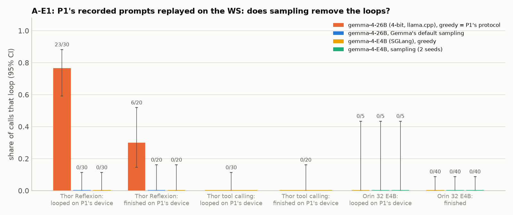
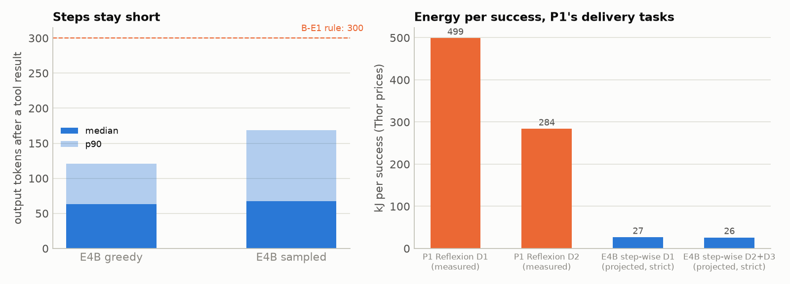
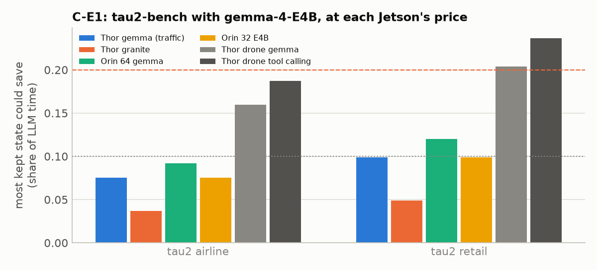
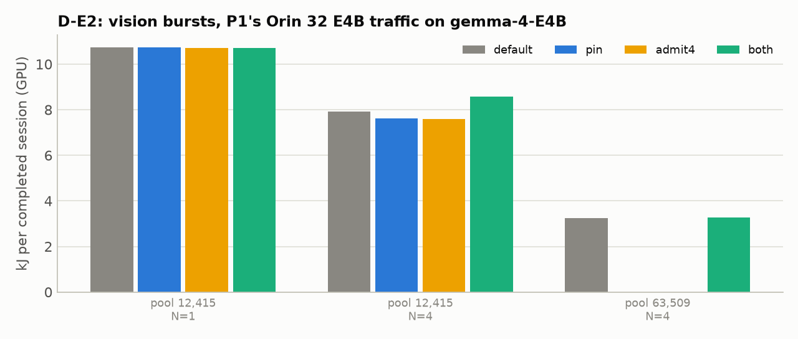
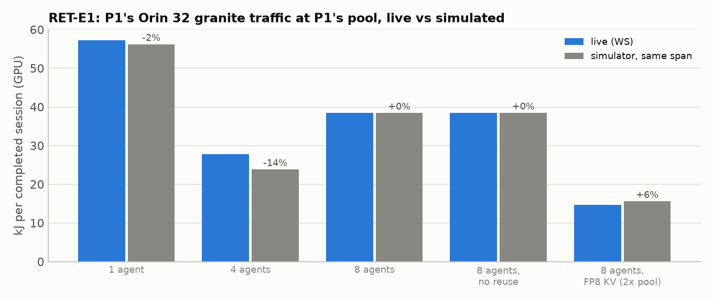
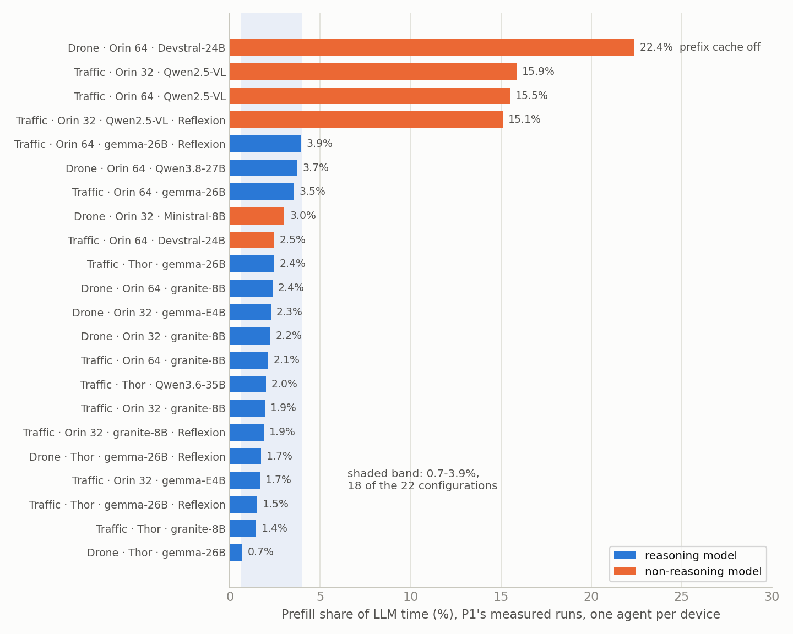
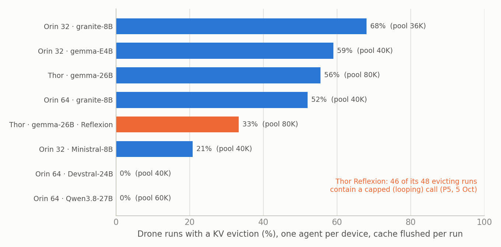
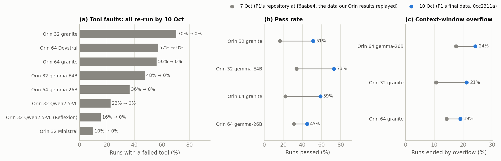

# P5's options side by side: the evidence for and against each

**CMP-2, 2026-10-06, updated 2026-10-11 for P1's submission (§12) and 2026-10-12 for corrections (update below) · Sai
Sandesh (P5)**, prepared with Claude Code. Plan:
[`../../planning/OPTIONS_PLAN.md`](../../planning/OPTIONS_PLAN.md) (G1); task status:
[`../../planning/TRACKER.md`](../../planning/TRACKER.md).

This doc lays out every option P5 could take, with the same criteria and the same template, so the professor
can choose with the pros, cons and open gaps side by side. Each option's gaps were filled this week (5-6 Oct)
with the cheapest experiment that could close them, on the workstation and on P1's recorded data, each with a
decision rule fixed before it ran (plan D15). It stays a separate doc; its results were merged into the evidence
doc, the teaching guide and the deck on 6 Oct. Our own lean is stated once, at the end (§9), and nowhere else.

**What this week found, in one line per option** (details and sources in §3-§8):
- **A. Decode-side energy:** on a 4-bit stand-in for P1's 26B (llama.cpp; one sampling seed at Gemma's default
  temperature of 1.0; Reflexion prompts only; pass rate under sampling unmeasured), greedy decoding loops on 77% of
  P1's loop prompts and sampling on none, so P1's drone runaways may be a decoding setting (A-J1 in plan v2.0 tests
  it on P1's bf16 26B on Thor-1). An online stop plus one resample recovers all 17 calls that looped again, at a
  median 60% of the capped cost (the pre-registered cost rule was not met: 10 of 29 at half the cost or less). Also
  measured: traffic's repeated capped tool calls (31-33% of gemma traffic LLM energy) and batching (13x less energy
  per token at batch 16).
- **B. Agent design:** with P1's own gemma-4-E4B, a step-wise agent keeps steps after tool results at a median
  63-68 tokens and passes the strict check 9 of 11 times greedy (7 of 13 sampled; 1 of 12 greedy and 8 of 21
  sampled missions were lost to a since-fixed tool-format bug and are not counted); projected 11-19x less energy
  per strict success than P1's Reflexion greedy, 7-14x sampled. That ratio rests on 9 strict successes greedy (7
  sampled) and stacks three differences: E4B's tokens priced at the 26B's Thor costs, a simulator without
  buildings, and our strict checker against P1's grader (§4).
- **C. Benchmarks:** tau2-bench's contexts accumulate (92-96% reuse), but with a thinking agent kept state is
  worth 7.5-9.9% of LLM time at E4B's Jetson price (up to 24% at Thor's drone prices); without thinking, 25%.
  Thinking decides.
- **D. Memory over time:** the vision burst's eviction reproduces live (88-100% recomputed). At one agent, pinning
  plus a burst cap of 2 prevents most of it (37% recomputed) but costs 11% more energy than recomputing (the only
  arm that took effect there). At 4 agents no policy reduces it by more than 4 points (100% → 96%), and the two
  arms about 4% below the default are not read as gains (§6). One run per setting [WS-meas].
- **CAP. Capacity:** live (one run per setting), an FP8 KV cache doubles granite's pool and cuts energy per
  generated token 53% at 8 agents (3.95 → 1.87 J) and 45% against bf16's best point (4 agents, 3.43 J; FP8 was run at
  8 agents only), with 2.6x the sessions per hour [WS-meas]. Per completed session the cut is 62%, but that figure is
  biased: sessions cut at the window's end are charged to the finished ones. A 5x larger pool cuts energy per
  completed session 2.4x for E4B at 4 agents [WS-meas]. FP8 KV for Gemma-4 failed on our A5000s in SGLang 0.5.20 (P1
  ran it on Orin 64 with SGLang 0.5.16), so FP8 quality is unmeasured on our side. P1's own data holds a natural pair
  that shows no loss (82.1% of runs passed with BF16 KV on Thor, 81.7% with FP8 KV on Orin 64) [P1-meas]. By
  CAP-E1's own rule that points to capacity being a free configuration choice, which is the main risk to the lean
  (§7, §9).
- **RET (the retention controller):** the simulator behind "no policy beats SGLang's default" held live, narrowly
  and on a run narrower than planned (Orin 32 granite traffic at P1's pool only; one run per point). It is within
  14.2% of the live engine per completed session at 1-8 agents (2% except at 4 agents; the rule allows 15%), within
  6% per generated token at every bf16 point, and it predicted the FP8 pool's effect within 6.4% per session. The
  4-agent gap is mostly which sessions finished in the window (21 simulated, 18 live). The ranking test was
  degenerate: at 8 agents the default keeps no state at all (0 of 102 calls reuse a cached prefix), so it ties with
  dropping state [WS-meas, sim].

**Update 12 Oct: five Jetsons, the meeting on Wed 14 Oct, and corrections.**
- **Devices and dates:** P5 now has five of P1's Jetsons (Thor-1, Orin-64-1, Orin-32-1/2/3), since 12 Oct. The WS is
  back. The professor meeting is **Wed 14 Oct**. First device results will be added here before it (plan:
  [`../../planning/OPTIONS_PLAN.md`](../../planning/OPTIONS_PLAN.md) v2.0).
- **Corrections applied today** (the checklist is in [`../../planning/TRACKER.md`](../../planning/TRACKER.md); the
  main ones):
  - **CAP's headline** (M2): now energy per generated token, −53% at 8 agents and −45% against bf16's best point
    [WS-meas]. The −62% per completed session stays, labelled as biased (§7).
  - **P1's FP8 pair** (M1): P1's own runs show no FP8 loss (82.1% against 81.7% passed) [P1-meas]. It works against
    the lean, and is added to §7 and §9 as its main risk.
  - **The loader bug** (M3): `analysis/p1_repo.py` skips P1's re-runs. It does not mix them in with the faulted
    originals, as this doc said (§12).
  - **RET** (C1, M8): "holds live" now says narrowly (4 agents), ranking degenerate, narrower than planned, and gives
    the per-token gaps (§8).
  - **A's drone result** (C2, M4): "a decoding setting" and "the fix is one line" are withdrawn. What was measured: a
    4-bit stand-in, one seed, Reflexion prompts only, pass rate unmeasured (§3).
- **Also fixed:** D-E2's table and verdict wording (M5); B's base, stacked differences and lost missions (M6, C3);
  "one run per setting" next to RET, CAP and D numbers (M7); numbers that disagreed now carry their task set, source
  and method (A1-A4, A6); overflow, FP8 and vision-tool wording (C4-C10, D1); §10 Q6 answered. The evidence doc, the
  teaching guide and the deck are corrected after this doc (tracker COR-3).

**Update 11 Oct: P1 submitted, and its final data removes the tool faults** (details and figures in §12). On 7 Oct we
flagged that 36-70% of the runs of each Orin traffic configuration we use had hit a failed tool (the Python sandbox's
container image missing, or the detection store's disk full). P1's final data (repository at `0cc2311a`, 10 Oct)
replaces every faulted run of those configurations with a re-run. For this doc:
- Our Orin traffic results replayed the faulted 7 Oct sessions: 59-88% of the sessions RET-E1 replayed and 61% of
  CAP-E1's (both Orin 32 granite); the traffic simulator used every run; D-E2 is barely exposed (4-9%).
- The simulator-against-live comparison stands, since both sides replay the same sessions.
- The absolute Orin numbers (FP8 KV −53% per generated token at 8 agents, −62% per completed session, the capacity
  knee, −31-46% from doubling the pool) are redone on the re-run sessions (the WS is back since 12 Oct; plan v2.0,
  P1F-2 and P1F-3). Two effects pull in opposite directions. Against its own re-run, a faulted run used 1.6× the
  energy on Orin 32 granite and 1.4× on Orin 64 granite (0.6-0.8× in the other configurations; the 7 Oct figure of
  1.7-4.2× against other runs of the same task was partly task mix), so granite sessions get shorter. But window
  overflows rose in the re-runs (Orin 32 granite 10.6% → 21.2% of runs, a doubling; Orin 64 gemma-26B 17.5% →
  24.2%; Orin 64 granite 14.3% → 19.0%), so memory pressure stays.
- P1's submitted paper reports the loops offline, lists the capacity levers as untested (though P1 ran FP8 KV in its
  held-out Orin 64 drone sweep, §7), and plans follow-ups that overlap A and CAP (MB4, MB5); see §12.

Source tags: **[P1-meas]** measured on P1's Jetsons (board energy); **[WS-meas]** measured on our workstation
(NVML GPU energy); **[sim]** our simulator; **[proj]** projected with a cost model; **[lit]** a paper (depth as
stated in the literature notes `lit_*.md`; re-check against the PDF before citing).

## 1. The decision

P5 asked how an edge serving system should manage the state an agent holds while it waits for a tool, to
minimise energy per successful task on Jetson Orin and Thor. On P1's agents the answer is "little to gain": kept
state is worth 1–4% of LLM time, and no memory policy beats SGLang's default by more than 2.4% (traffic) or 9.9%
(drones) in simulation, a simulator that held live this week, narrowly (RET, §8). So the professor chooses what P5
studies instead, or whether it stays with retained state in another form:

| Option | In one line |
| --- | --- |
| **A. Decode-side energy** | Stop runaway decodes online in the serving layer, retry well, budget thinking, batch long decodes |
| **B. Agent design** | A step-wise agent with flight-level tools uses far less energy per success than P1's whole-program agents |
| **C. Standard benchmarks with injected waits** | The original retained-state question, on τ²-bench/BFCL with P1-like waits |
| **D. Memory that changes over time** | Admission and retention when model-backed tools or co-located models take and release unified memory |
| **CAP. Capacity** | KV precision, fixed-prompt size and tool-output caps as levers, as configuration or chosen at run time |

Combinations are possible (§8).

## 2. Side by side

The criteria (plan §2.2, D16): **K1** prize, **K2** evidence strength, **K3** novelty, **K4** edge specificity,
**K5** generality, **K6** feasibility, **K7** dependence on P1, **K8** risk.

| | A. Decode-side | B. Agent design | C. Benchmarks + waits | D. Memory over time | CAP. Capacity |
| --- | --- | --- | --- | --- | --- |
| **K1 Prize** | Decode in capped calls: 67–69% of board energy (drone, Thor gemma), 38% (traffic, Thor gemma), 33% (Orin 32 E4B traffic), 0–19% elsewhere [P1-meas] | With P1's own E4B: 26–40 kJ per strict success on D1–D3 against P1's Reflexion 284–499 kJ (11–19× greedy on 9 strict successes, 7–14× sampled on 7; E4B's tokens priced at the 26B's Thor costs, our kinematic sim and checker) [proj from WS-meas] | Kept state worth 7.5-9.9% of LLM time at E4B's Jetson price with thinking on (up to 24% at Thor's drone prices), 25% with thinking off (tau2) [WS-meas] | Vision burst: 0.6% of LLM time at one agent [P1-meas]; live, pin + burst cap 2 cuts the eviction at one agent (88% → 37%) at +11% energy; at 4 agents no policy reduces it (pin −3.8% and cap 4 −4.05% are not read as gains: within 5%, one run each; others +3–14%) [WS-meas, one run per cell] | Live: FP8 KV (2x pool) cuts energy per generated token 53% at 8 agents (granite; −45% against bf16's best point; −62% per completed session, biased by sessions cut at the window's end); a 5x pool cuts energy per completed session 2.4x at 4 agents (E4B); batching cuts J/token 13x [WS-meas, one run per setting]; doubling the pool: −31–46% at 8 agents on Jetsons [sim]; overflows end 19–24% of Orin tool-calling traffic runs, up to 28% (P1's final data) [P1-meas] |
| **K2 Evidence** | Energy measured; a 4-bit stand-in for P1's 26B (llama.cpp) loops on 23/30 of P1's loop prompts under greedy and on 0/30 with Gemma's default sampling (one seed, temperature 1.0; Reflexion prompts only; pass rate unmeasured); E4B loops on none on the WS [WS-meas] | Step sizes measured with P1's E4B (24 missions read, 9 more lost to a since-fixed bug) and projected; still no Jetson run | tau2-bench measured on the WS (40 tasks, E4B) | Mechanism and policies measured live on the WS (D-E2, one run per cell, gemma-4-E4B) | Pool-size effect measured live (D-E2, RET-E1, CAP-E1; one run per setting); the simulator held live, narrowly, within 14.2% per session and 6% per token; FP8 quality unmeasured by us (Gemma-4 FP8 KV failed on our A5000s), while P1's natural pair shows no loss (82.1% against 81.7% passed) [WS-meas, P1-meas] |
| **K3 Novelty** | Partly covered: loop stop + recovery (Word Salad Chopper), energy-motivated agent stop (AgentStop), stop + restart (Fail-Fast), early exit in SGLang (Dynasor); P1's paper reports the loops [lit] | Direction known (Cost of Dynamic Reasoning, Sustainable Agents, CodeAct, AeroGen); this exact comparison not found [lit] | Generic version published (INFERCEPT, Continuum, TokenCake, Adaptive KV Retention, CacheScout) | Elastic KV (Prism/kvcached, MorphServe) and tool-aware pinning (Continuum, MORI) exist; tool foreknowledge on unified memory not found [lit] | Each lever studied (TriAxialKV, Less-is-More, CarbonCall, Complexity Trap, FP8 KV); a run-time controller across levers not found [lit] |
| **K4 Edge** | Decode is 96–99% of LLM time on Jetsons, except Qwen2.5-VL (prefill 15–16%) and Devstral drone (22%); board power; weak MoE batching | Drones per device; the price of a generated token | Weak: edge only through injected waits and prices | Strong: unified memory, model-backed tools on one board | Strong: small pools on 32–64 GB boards |
| **K5 Generality** | Any thinking agent; loops depend on model and stack (E4B on the WS never loops) [WS-meas] | Task-dependent; delivery tasks only | High | Agents with model-backed tools | High |
| **K6 Feasibility** | Detector, gateway, decode guard built and run live on a 4-bit stand-in for P1's 26B | aerogen driver + gateway shim run P1's E4B; needs a building-aware sim | τ²-bench + gateway run end to end | Gateway, replayer and burst policy built and run live | Replayer and calibration built; FP8 path for Gemma blocked on our A5000s (it ran on P1's Orin 64) |
| **K7 Dependence on P1** | High: P1's paper reports the loops offline and plans capped-call replays (MB4); split to agree | High: agent design is P1's territory | Low | Medium: P1 plans a vision-tool study (MB6); devices for real unified memory | Medium: P1's paper lists these levers as untested (though P1 ran FP8 KV in its held-out Orin 64 drone sweep) and plans an FP8 window probe (MB5) |
| **K8 Risk** | Possibly realised for drones: on a 4-bit stand-in sampling removes the loops (one seed; Reflexion prompts only; pass rate unmeasured), which would make it a configuration fix for P1; what is left is smaller | Attributable to agent engineering; the strict ratio is 1.2–9.6×, close to parity at its low end | Waits are synthetic; may collapse like traffic | Realised here: protecting the paused context costs more than recomputing it on these GPUs | A good static setting may capture it all: P1's FP8 pair shows no loss (§7) |

## 3. A. Decode-side energy

**What P5 would study.** The serving layer watches each call as it streams, stops a call that has started to
repeat itself, and decides what happens next (return it capped, retry it resampled, nudge it, give it less
budget), judged by energy per successful task and runs lost. Plus thinking budgets, and how long decodes from
several agents share a device.

**The claim a paper could make.** "On edge devices running thinking agents, most energy is spent in decodes
that run to their cap. An online, text-only stop in the serving layer with a retry policy recovers X% of energy
per successful task, losing Y runs, where sampling alone recovers Z%."

**Evidence for.**
- Decode in capped calls takes 67–69% of board energy for both drone agents on Thor gemma, 38% for traffic on Thor
  gemma and 33% for Orin 32 gemma-E4B traffic; 0–19% elsewhere [P1-meas].
- In drone runs they are repetition loops: 121 of 122 capped Reflexion calls and 127 of 127 tool-calling
  calls capped at 32,768 [P1-meas, our detector on recorded text].
- An online stop at the detector's firing point would save 43.5% of board energy on Reflexion (all 16 tasks; about
  31% on the 12 tasks tool calling also ran) and 35.7% on tool calling (those 12 tasks, our 104-run copy), and stop
  none of the 173 (Reflexion) and 194 (tool calling) long calls that finished on their own (upper bound). P1's
  first-cap rule saves 50.2% and loses 22 passing runs on Reflexion, and 66.6% and 17 on tool calling (P1's paper,
  144 runs each; on our 104-run copy 63.1% and 16) [P1-meas, replayed].
- In traffic, the waste is a capped tool call that is dropped and retried: 121 of 158 capped calls on Thor
  gemma follow a capped call; stopping at the second consecutive cap saves 27% (1 completed run lost), 25% on
  Orin 32 E4B (7 lost) [P1-meas].

**Evidence against.**
- The cause may be greedy decoding: on the WS, a 4-bit stand-in for P1's 26B loops on 77% of P1's Reflexion loop
  prompts under greedy and on none under Gemma-4's own default sampling (A-E1, below; one seed, temperature 1.0,
  pass rate unmeasured); Qwen3.5 ran away only under greedy too (0 of 21 sampled missions) [WS-meas]. If P1's bf16
  26B behaves the same on its Thor (A-J1), the drone fix is configuration.
- P1's submitted paper reports the loop finding itself (offline compression test, stop-at-first-cap bound); it
  leaves an online policy to "separate evaluation" and plans capped-call replays after submission (MB4).
- Our traffic analyses predate P1's traffic grades (7 Oct), so "runs lost" there counts completions, not correct
  answers.

**Novelty** (`lit_A.md`; 25 works). Partly covered. Published: stopping reasoning that repeats itself and
recovering with a forced conclusion (Word Salad Chopper, EMNLP 2025; Circular Reasoning, 2026), energy-motivated
early termination of local agents (AgentStop, CAIS 2026), stop-and-restart for agents (Fail-Fast
Restart-Smart, 2026), early exit inside SGLang (Dynasor), thinking budgets evaluated on Jetson Orin
(EdgeReasoning). Not found: the combination of an engine-side, training-free text detector for thinking-on agent
calls, a retry policy for capped tool-call bodies, and energy per successful task on Jetson boards, including the
cost of wrong stops. Moderate novelty, mostly empirical.

**Edge specificity.** On P1's Jetsons decode is 96–99% of LLM time and prefill 0.7–3.4% of board energy, except
Qwen2.5-VL (prefill 15–16% of LLM time) and Devstral drone (22%, its prefix cache off) (P1's submitted paper: prefill
0.7–3.9% of LLM time in 18 of its 22 configurations with a split); board
power stays high through a runaway decode. Weak batching on mixture-of-experts models (a 16-request decode step
takes ~5.3× one on Thor gemma [sim fit]) makes one runaway hold the device. Board energy needs a Jetson; the WS
can replay P1's exact prompts on a stand-in model.

**Dependence on P1.** P1 owns the observation; P5 could own the online mechanism and its evaluation (Sandesh:
build now, agree the split now that P1 has submitted; P1's planned MB4 replays overlap A-E1/A-E2). The sampling result (A-E1, on a 4-bit stand-in) is a lead P1 can test directly.

**What would change our mind.** This happened for the drone agents, on a 4-bit stand-in (one seed; Reflexion
prompts only; pass rate unmeasured): sampling removes the loops on the stand-in for P1's 26B without hurting
finished calls (A-E1). A then rests on the traffic agent's repeated caps, a safety net (A-E2: it works, but costs
more than sampling from the start), budgets and batching.

**This week.**
- **A-E4, traffic's capped calls** (`a_e4.json`; P1's traces) [P1-meas]:
  - On gemma the waste is a few runs looping through capped `run_python` calls: on Thor gemma 121 of 158 capped
    calls follow a capped call, chains run up to 21 calls, and the repeats after a run's first cap hold 33% of its
    LLM-call energy. Orin 32 E4B: 64 of 76, chains up to 20, 31%.
  - Where the text survives, the cap hits inside a dropped `run_python` body (30 on Thor gemma, 62 of 76 on E4B)
    or inside the reasoning (21 on Thor gemma). Granite caps mostly inside its reasoning and rarely repeats
    (repeats ≤ 3% of energy); Orin 64 gemma's caps are all the context guard (capacity).
  - Runs with a cap complete 4 of 33 times on Thor gemma but 10 of 11 on E4B: on E4B the retries eventually work,
    at great cost, so a blunt stop would lose completions where a better retry might keep them.
- **A-E1, do the loops survive sampling?** (`a_e1.json`; P1's recorded prompts replayed exactly) [WS-meas]:
  - **gemma-4-E4B does not loop on the WS, even greedy:** 0 of 60 of the 26B's Thor loop prompts (95% upper bound
    about 6% for the 60, 11% for each set of 30), 0 of 40 controls, and 0 of its own 5 Orin 32 loop prompts under
    greedy or two sampled seeds. On the Thor prompts every call finished, in a median 1.9-3.6K tokens. In the Orin 32
    arms, 2-3 of 40 controls and (in the sampled arms) 1-2 of the 5 loop prompts hit the cap without looping (medians
    3.4-6.0K tokens). Under the pre-registered rule this is inconclusive (no reproduction),
    and it says loops depend on more than greedy decoding: on the model, and apparently on the serving stack or
    device (E4B looped on all 5 on P1's Orin 32; P1 reports inference varying between repeats there).
  - **P1's gemma-4-26B-A4B through llama.cpp (4-bit GGUF; SGLang cannot run any 26B on our GPUs) reproduces the
    loops under greedy, and Gemma's default sampling removes them** (P1's Thor Reflexion prompts only, 30 that
    looped and 20 that finished on P1's device; one sampling seed at temperature 1.0; the pass rate under sampling
    is not measured):

    | | Greedy (P1's protocol) | Gemma's default sampling |
    | --- | --- | --- |
    | Looped on P1's Thor (30) | **23 loop (77%; 95% CI 59-88%)**; 7 finish | **0 loop (0-11%)**; 29 finish, 28/28 programs valid |
    | Finished on P1's Thor (20) | 6 loop (30%) | 0 loop; 20 finish |
    | Output tokens, median (loop prompts) | 11,574 (stopped by the detector) | 8,136 |
    | GPU energy for the 50 prompts | 685 kJ (loops stopped early) | 483 kJ |

    The greedy loops trip the detector at a median 11.6K tokens, as P1's did on the Thor (35% of 32,768). The
    4-bit model loops somewhat more readily than P1's bf16 one (6 of 20 controls). Verdict under the
    pre-registered rule: **sampling removes the loops**.

    

  - **What this means for A.** The largest energy item in P1's drone runs (capped decodes, 67-69% of board energy
    on Thor gemma) may be a decoding configuration problem: P1 runs temperature 0, the model's own generation
    config samples (temperature 1.0, top_k 64, top_p 0.95). On the 4-bit stand-in sampling removes the loops (one
    seed; Reflexion prompts only; pass rate unmeasured). That is a lead for P1, not yet a fix: it needs a test on
    P1's bf16 26B and drone harness, with pass rates (A-J1, A-J2). What remains for P5 under A is the safety net
    (an online stop for residual loops, A-E2's retries), the traffic agent's repeated capped tool calls (A-E4),
    budgets and batching of long decodes.
- **A-E2, stop and retry** (`a_e2.json`; the 29 prompts that looped under greedy in A-E1, 23 of the 30 loop prompts
  and 6 of the 20 controls, replayed greedy on the
  4-bit 26B stand-in; the gateway stops a call where the detector fires and retries once) [WS-meas]:
  - 17 of 29 looped again (greedy on llama.cpp is not bit-reproducible across its parallel slots, as P1 saw
    repeats differ at temperature 0). **All 17 resampled retries finished with a valid result.** The stop came at a
    median 12.2K tokens and the retry needed 7.7K: 19.7K in all, against P1's recorded 32,768 (about 40% saved).
  - Overall 28 of 29 prompts ended with a valid result (95% CI 83-99%), but only 10 of 29 at half the recorded cost
    or less, so the pre-registered rule (>= 70% at <= 50%) is **not met**. Sampling from the start is cheaper
    (A-E1: a median 8.1K tokens on the same prompts, no loops).
  - So the online stop is a reliable **safety net** for deployments that must decode greedily (a stop plus one
    resample recovers every looping call), not the main energy lever.
  - **A nudge does not break a greedy loop:** retrying greedy with a note that the attempt repeated itself (12
    prompts; 10 looped again and were retried) re-looped in 7 of the 10 retries, and only 2 of the 10 ended valid
    (4 of the 12 prompts overall). The retry has to change the decoding.
- **A-E5, batching of decodes on one A5000** (`jsw/costs/calibrate2.py`; GPU energy) [WS-meas]: going from batch 1
  to batch 16 cuts the energy per generated token 13x on granite-4.2-8b (5.3 → 0.41 J) and 13.5x on gemma-4-E4B
  (3.40 → 0.25 J), while a decode step takes only 4.5% (granite) and 20% (E4B) longer. Concurrency is the strong
  lever on this GPU; P1's runs serve one request at a time. (The 26B could not be calibrated in SGLang;
  P1's Thor fit says its experts make batching weaker: a 16-request step ~5.3x one.)

> **WS version (G2).** Built: the streaming loop detector (`jsw/policies/loop_detector.py`; fires at exactly the
> offline position on all 1,620 recorded Thor calls, reproducing the 121 + 127 counts), the gateway
> (`jsw/gateway/`; ~0.3 ms per call) and the decode guard (`jsw/policies/decode_guard.py`: truncate, resample,
> nudge or budget after a stop; a session stop after k consecutive caps), tested end to end against a fake
> engine and run live in A-E1 (stops) and A-E2 (stop + retry on P1's 26B). Not yet run inside a live agent loop.

## 4. B. Agent design

**What P5 would study.** The agent paradigm as the energy lever: a step-wise agent (one tool call per flight
action, one growing conversation) against P1's whole-program agents (Reflexion; one program per tool call), on
P1's tasks, measured by energy per successful mission and agents per device.

**The claim a paper could make.** "For drone missions on edge devices, a step-wise agent uses N× less energy
per successful mission than whole-program generation, because steps after a tool result stay short and the
growing conversation is reused, and it fits M× more drones per device."

**Evidence for.**
- On P1's delivery tasks D1–D3, a step-wise agent writes a median 55–99 output tokens after a tool result
  (p90 ≤ 394) in every configuration tested [WS-meas, 108 missions, Qwen3.5-9B and K2-Horizon-7B].
- Projected to Thor costs with the 3 Oct stand-ins (Qwen3.5-9B and K2-Horizon-7B step sizes; success = delivered and
  returned): 22–68 kJ per success against P1's Reflexion 284–499 kJ (D2 and D1; 144 runs), 6–13×; 4–16 drones per
  Thor within 1.5× p95 mission time against 2 [proj, sim]. The 3 Oct report said 219–499 kJ and 5–13×: its D2 figure
  covered 8 of the 9 D2 runs (our copy then lacked P1's 144th Thor Reflexion run, a looping run that did not pass).
  With that run D2 is 284 kJ per success (3 passes either way). The E4B projection below uses the same Reflexion
  figures.
- P1's two agents on the same 12 tasks: tool calling 231 kJ per success, Reflexion 79 kJ (2.9×), because of
  runaway thinking [P1-meas].

**Evidence against.**
- Under the strict check (order, descent and hold, no flight through a building) the ratio falls to 1.2–9.6×
  (0.9–9.6× on 3 Oct, with the 219 kJ D2 figure); only 27% of step-wise missions pass it, because the kinematic sim
  has no buildings [WS-meas].
- Gemma-4's own step sizes were unmeasured until this week; now measured with gemma-4-E4B (B-E1, below).
- The win belongs to the agent, which is P1's territory; a memory controller adds at most ~10% on top [sim].

**Novelty** (`lit_B.md`; 25 works). The direction is known with energy numbers: iterative designs (Reflexion,
LATS, multi-agent) cost far more than lighter loops (Cost of Dynamic Reasoning, KAIST; Engineering Sustainable
Agents; energy per successful goal, A-LEMS); code actions need fewer turns than JSON tool calls (CodeAct);
single-shot drone programs beat closed-loop generation on tokens (AeroGen, the supervisor's group). Not found:
step-wise vs whole-program vs Reflexion on the same embodied tasks with energy per success on edge hardware,
and the serving effects (prefix reuse, drones per device). As a paradigm comparison it overlaps P1's agent study and
the AeroGen line more than serving work.

**Edge specificity.** Through drones per device and through r, the price of a generated token in prefilled ones
(52–312 on P1's Jetsons): short steps matter most where decode is expensive.

**Dependence on P1.** High. Running P1's AeroEval tasks with a step-wise agent is an open question for P1's
mentor (task overview §9); extending aerogen needs its author's OK.

**What would change our mind.** Gemma-4 writes long steps after tool results (median > 300 tokens, B-E1's rule;
it did not: medians 63-68), or a fair whole-program arm with guardrail prompts closes the gap (not tested).

**This week: B-E1 and B-E2** (`b_e1.json`, `b_e2.json`; WS, gemma-4-E4B with P1's weights, aerogen's loop, P1's
D1–D3 texts and delivery world, thinking on, 33 missions).
- **E4B keeps its steps short.** After a tool result it writes a median 63 tokens under P1's greedy protocol (p90
  121, max 284) and 68 when sampled (p90 169, max 539); the planning call writes a median 1,204–1,574; no call hit
  its cap. B-E1's rule (median ≤ 300) holds for P1's model family [WS-meas].
- **It passes the strict check more often than the 2 Oct stand-ins:** 9 of 11 greedy missions and 7 of 13 sampled
  (Qwen3.5 and K2: 27%). These are the missions that ran: 1 of 12 greedy and 8 of 21 sampled missions were lost to
  the tool-format bug below and are not counted [WS-meas].
- **Projected at Thor gemma-26B prices** (the 2 Oct method): 26.6 kJ per strict success on D1 and 26.2 on D2+D3,
  against P1's Reflexion measured at 499 kJ (D1) and 284 kJ (D2; D3 had no passes): **11–19×** greedy [proj];
  sampled, 34.6 and 39.7 kJ (7–14×). At Orin 32 E4B prices (P1's fit on its own E4B calls): 17–19 kJ greedy, 22–27
  kJ sampled [proj]. The projection reads 10 greedy and 12 sampled missions (one failed mission per arm is not
  read by its loader; the strict successes, 9 and 7, are all included), so energy per strict success is slightly
  low.
- **What the ratio rests on.** On the E4B side, 9 strict successes greedy (6 on D1, 3 on D2+D3) and 7 sampled (4 and
  3). On P1's side, Reflexion passed 5 of 9 runs on D1 and 3 of 9 on D2 [P1-meas]. Three differences are stacked in
  it: the step-wise agent is E4B on the WS, priced at the 26B's Thor costs, while Reflexion is measured on the 26B on
  Thor; the sim has no buildings; and success is our strict checker on one side and P1's grader on the other. It is
  a projection, not a measurement on a Jetson.
- **But E4B does not always use its tool-call format.** With aerogen's prompt (whose examples show calls as
  Python text) it sometimes writes the call as text, or writes the whole mission in one reply with imagined tool
  results. The gateway converts such calls (`jsw/gateway/pythonic.py`), but 9 of 33 missions (1 greedy, 8
  sampled) still ended at the first call because of a conversion bug, since fixed and not yet re-run. These
  missions are left out of the numbers above.

  
- Caveats: the projection applies the 26B's per-token costs to E4B's token counts (as the 2 Oct projection
  applied them to Qwen's); the kinematic sim has no buildings, and success is judged by our strict checker, not P1's
  grader; one run per configuration.

> **WS version (G2).** The aerogen driver (`jsw/workloads/aerogen_driver.py`) runs a step-wise agent on P1's
> task texts; a building-aware sim (B-P1) waits for the author's OK.

## 5. C. Standard benchmarks with injected waits

**What P5 would study.** The original question (keep, drop, offload or recompute paused state) on standard
agent benchmarks with accumulating contexts, with tool waits injected from P1's measured distributions, so the
results compare directly with prior work.

**The claim a paper could make.** "With edge prices and waits of seconds to minutes, the best retention policy
differs from published ones by X%."

**Evidence for.**
- Easy comparison with INFERCEPT, Continuum, Adaptive KV Retention (which use BFCL, SWE-bench, τ²-bench) [lit].
- Accumulating native tool-calling contexts reuse 96–99% of prompts in published measurements (MLPerf Edge
  Agentic, AgentSysBench) [lit].
- Adaptive KV Retention's break-even hold time (t* ≈ 109 s on an H100) falls inside P1's flight waits
  (median 17–113 s) [lit].

**Evidence against.**
- P1's own accumulating-context agent (traffic) has 56–82% cache reuse yet kept state is worth only 1–4% of
  LLM time, because its steps write 424–999 tokens and the state idles 1–3 s [P1-meas]. A benchmark agent with
  thinking on may behave the same.
- P1's real tools return in 0.5–3 s; long waits would be synthetic.
- It loses the drone and traffic story and P1's devices.

**Novelty.** The generic version is published (INFERCEPT, Continuum, TokenCake, Adaptive KV Retention,
CacheScout; Track B F1–F10). What the edge adds would come only through the injected waits and Jetson prices.

**Edge specificity.** Weak.

**Dependence on P1.** Low; only P1's wait distributions.

**What would change our mind.** τ²-bench steps are short enough that the ceiling P/(P + r·O) at a Jetson r is ≥ 20%
of LLM time (C-E1's rule). Outcome below: without thinking, yes; with thinking, only at Thor's drone prices.

**This week: C-E1** (`c_e1.json`; tau2-bench on the WS, gemma-4-E4B as the agent with thinking on and as the
user simulator, one conversation at a time, 20 tasks per domain) [WS-meas]:

| Domain | Passed (mean reward) | Agent calls per conversation | Context: first → peak, growth per step | Output per step (median / p90; reasoning share) | Reuse | Ceiling at E4B's own device (r = 147) | At Thor's drone prices (r = 52-63) |
| --- | --- | --- | --- | --- | --- | --- | --- |
| Airline | 10/20 (0.50) | 10 | 3.9K → 5.8K, +182 | 333 / 831; 83% | 93.5% | 7.5% | 16-19% |
| Retail | 3/20 (0.20) | 10 | 4.5K → 7.5K, +197 | 280 / 696; 80% | 92% | 9.9% | 20-24% |
| **Airline, thinking off** | 10/20 (0.50) | 6.5 | 3.9K → 5.4K, +212 | **75 / 227; 0%** | 96% | **25%** | **44-49%** |

- **The context accumulates as published benchmarks promise** (92-94% of prompt tokens from the cache), but with
  thinking on each step writes hundreds of tokens, so kept state is worth at most 7.5-9.9% of LLM time at E4B's
  own Jetson price. The rule as written fires for retail (20-24% at Thor's drone prices, r = 52-63), not for
  airline (at most 19%). We read it as **borderline**: the 20% needs the 26B's Thor price with E4B's step sizes;
  at E4B's own device price both domains are below 10%, close to the traffic result.
- **Without thinking, C has an opportunity.** With the agent's thinking off, E4B passes the same 10 of 20 airline
  tasks, writes a median 75 tokens per step, and kept state is worth up to 25% of LLM time at E4B's own Jetson
  price (33% on the WS, r = 101; 44-49% at Thor's): C-E1's rule says **opportunity**. Whether kept state matters
  is decided by whether the agent thinks at each step, the same split as between P1's agents and the step-wise
  agent (B).
- The ceiling is an upper bound on what any retention policy could save; SGLang's radix cache already keeps state
  when memory is plentiful (tau2's tools return in milliseconds), so a policy's share depends on memory pressure
  from other sessions, which this single-session run does not measure (for step-wise drone agents the simulator
  found the default within 9.9% of every policy).
- Waits: tau2's tools return in milliseconds; an edge version needs injected waits, which matter in proportion to
  the ceiling.

  

> **WS version (G2).** C-P1 (τ²-bench through the gateway with published baselines) is built only if C-E1 finds
> an opportunity: it did for non-thinking agents, so C-P1 would use them; the gateway already runs tau2-bench.

## 6. D. Memory that changes over time

**What P5 would study.** Admission and retention when model-backed tools, co-located models or simulators take
and release unified memory during an agent's run: pin a paused context through a known burst, admit a burst at
lower concurrency, or resize the pool, judged by energy per successful task.

**The claim a paper could make.** "On unified-memory edge devices, an agent's own tools change the memory
available to it; a serving layer that uses its foreknowledge of tool calls recovers X% of energy per task at N
agents per device, where policies tuned for a fixed budget recover nothing."

**Evidence for.**
- P1's vision tool (`ask_vlm`) sends 8–45 concurrent requests (median 8–23) to the agent's own server; on Orin
  64 gemma (12.4K-token pool) the burst fills 99.5% of the pool and evicts the paused agent's context before
  every one of the 62 calls that follow it (90% of the prefix recomputed); 12 of 50 on Orin 32 E4B; none on Thor
  gemma. On Thor Qwen3.6, 17 of the 81 calls after a burst missed their prefix (15% recomputed), but the burst peaks
  at 1% of its pool, so that is not memory pressure: the model also misses after other tools (51 of 274), because
  its hybrid state is reused only at checkpoints [P1-meas, server counters].
- Small pools cap consolidation: with 8 agents the gap to unlimited memory is 33–64% on the Orins [sim].

**Evidence against.**
- The recompute the burst causes is 0.6% of LLM time at one agent per device, because prefill is cheap
  [P1-meas].
- Most of the 33–64% gap is capacity, which configuration recovers (CAP), not policy.
- A 2026 paper on elastic KV inside one engine found reclaiming memory worth about 1% TTFT [lit, abstract].
- Before its submission P1 described `ask_vlm` as a second model, and its microbenchmark targets a separate
  endpoint; our reading is from the agent server's request counters only. P1's submitted paper now calls the vision
  tool "the agent's own model reading images" (our correction 1, taken up in part); it does not mention the burst or
  its evictions.

**Novelty** (`lit_D.md`). Run-time resizable KV pools exist (Prism/kvcached, open source on SGLang 0.5.20;
MorphServe), as does tool-aware pinning (Continuum, MORI); on-device KV under a budget (LLMS on Jetson Orin NX;
mzCache on phones). Not found: a serving policy that knows a tool will take memory on the same device and uses
it to pin, throttle or resize, judged by energy per task on unified memory.

**Edge specificity.** Strong: unified memory has no host tier, and tools that run models share the board.

**Dependence on P1.** Medium: P1's submitted paper calls the vision tool the agent's own model, which fits our
reading that the contention is inside one engine; it does not mention the burst (our correction 1, taken up in
part). Real unified-memory behaviour needs a device.

**What would change our mind.** D-E2: the best policy stays within 5% of the default at 4 agents. Outcome below:
it did (the lowest cells are a burst cap of 4, 4.05% below the default, and pinning alone, 3.8% below; the others
cost 3-14% more). Neither is a measured gain: pinning recomputed 191,604 tokens against the default's 195,432 (100%
of the prefix both times), and each cell is one run.

**This week: D-E2** (`d_e2.json`; P1's Orin 32 E4B traffic sessions with `ask_vlm` bursts, replayed on gemma-4-E4B
with the bursts sent as real concurrent requests; one run per cell) [WS-meas]:
- **The mechanism reproduces live:** at a 12,415-token pool the call after a burst recomputes 88-100% of its
  paused prefix (P1's Orin 64 data: 90%); at the full 63.5K pool, 43%.
- **At one agent the burst-aware policy that took effect (D-P1, pin + cap 2) stops most of the eviction but costs
  more than it saves; the other three never took effect. At 4 agents none stops it.** One run per cell; energy per
  completed session against SGLang's default:

  | Pool, agents | Default | Pin (agent > burst priority) | Burst capped at 2 | Burst capped at 4 | Pin + cap 2 | Pin + cap 4 | Prefix recomputed after a burst (default → pin + cap 2; last row: pin + cap 4) |
  | --- | --- | --- | --- | --- | --- | --- | --- |
  | 12.4K, 1 | 10.75 kJ | -0.2% (no effect) | — | -0.4% (no effect) | **+11.4%** | -0.4% (no effect) | **88% → 37%** |
  | 12.4K, 4 | 7.92 kJ | -3.8% | +3.2% | -4.05% | +14.0% | +8.2% | 100% → 96% |
  | 63.5K, 4 | 3.25 kJ | — | — | — | — | +0.7% | 44% → 43% |

  - At one agent, pinning the paused context and admitting the burst 2 requests at a time keeps most of the
    context (recompute 88% → 37%), but the tool runs longer (5.3 s against 4.1 s per burst), so energy per
    session rises 11%: on this GPU re-prefilling a ~7K-token context is cheaper than throttling the tool. The other
    three arms (pin, cap 4, pin + cap 4) never took effect: each recomputed the same 115,573 tokens as the default,
    so their −0.2% to −0.4% is the spread between runs that did the same thing.
  - At 4 agents the agents' contexts alone exceed the 12.4K pool, so eviction is capacity, not the burst;
    throttling only slows the tool (+3% to +14%). (The cap-4 arms are a first attempt at admission, gated on the
    pool-usage metric; at one agent it never engaged because the burst arrives within one metrics poll. Pinning
    alone cannot help when the burst exceeds the free pool.)
  - **The two cells below the default at 4 agents are not gains.** Pin (−3.8%) recomputed 191,604 tokens against the
    default's 195,432 (100% of the prefix both times), so its difference is noise. Cap 4 (−4.05%) recomputed 96%.
    There is no repeat to measure the noise, and both are inside the 5% rule, so the verdict stands: D's live case is
    small.
- **Capacity dominates:** with 4 agents, the 63.5K pool needs 3.25 kJ per completed session against 7.92 kJ at
  12.4K (2.4x less) and completes 46 sessions against 19 in the same time (one run per cell); 4-5 sessions per run
  at 12.4K could not run at all (prompts larger than the pool, as P1's Orin 64 overflows). This is the pool-size
  lever of CAP (§7), measured live.

  

> **WS version (G2).** Built: the gateway with tool-tagged routes and tool events, and the trace replayer
> (`jsw/workloads/replay.py`) with burst injection, and the burst-aware memory policy (`jsw/policies/burst_memory.py`:
> pin by request priority, burst admission k), evaluated live in D-E2.

## 7. CAP. Capacity

**What P5 would study.** KV precision (FP8/INT4), fixed-prompt and tool-definition size, and tool-output caps as
the levers that decide how many agents fit a device, either as configuration or chosen at run time from pool
pressure, judged by energy per successful task and task success.

**The claim a paper could make.** "On 32–64 GB edge boards, capacity sets energy per task for multi-agent
serving; a measured design space of KV precision, prompt size and output caps shows which lever buys how much
capacity per quality point, and a run-time controller recovers X% beyond the best static setting."

**Evidence for.**
- Live, P1's Orin 32 granite traffic at 8 agents: an FP8 KV cache (twice the pool) cuts energy per generated token
  53% (3.95 → 1.87 J) and raises sessions per hour 2.6x; against bf16's best point (4 agents, 3.43 J per token; FP8
  was run at 8 agents only) the cut is 45%. At P1's bf16 pool the engine keeps no state at all (CAP-E1, RET-E1)
  [WS-meas, one run per setting].
  Per completed session the cut is 62%, but that figure is biased: sessions cut at the window's end are charged to
  the finished ones (bf16: 13 finished, 6 cut; FP8: 34 finished, 7 cut).
- Traffic, 8 agents per device: doubling the pool cuts energy per completed task by 31–46% on the Orins; no
  retention policy comes close (≤ 2.4%) [sim, a simulator that held live within 14.2% per session and 6% per token].
- Drones: an FP8 KV cache recovers 10–34% at 1–4 GiB of state [sim].
- Window overflows end 19–24% of Orin tool-calling traffic runs in P1's final data, up to 28% with Reflexion
  (10.6–17.5% on 7 Oct; 21% for Orin 64 gemma in our 5 Oct read); the fixed prompt (system text and 7 tool
  definitions, 3.9–5.1K tokens) is 38% of Orin 64 gemma's window [P1-meas].

**Evidence against.**
- **P1's own data holds a natural FP8 pair, and it shows no loss.** P1's gemma-26B Reflexion drone agent passed 96 of
  117 runs (82.1%) on Thor with BF16 KV and 94 of 115 (81.7%) on Orin 64 with FP8 KV (fp8_e5m2, confirmed on the
  unit's server on 12 Oct), on the 39 task-instances both ran. Runs with a capped call rose from 33% to 42%; energy
  per success was 105 kJ against 92 kJ (same order; different boards) [P1-meas]. Caveats: the device and the pool
  differ (80K tokens on Thor, 60K on Orin 64), a pass rate is a coarse measure, and P1 ran one request at a time. By
  CAP-E1's own pre-registered rule, no measurable FP8 degradation means capacity is a free configuration choice (a
  finding to report to P1, and CAP weakens as a research option). This is the lean's main risk (§9).
- These are configuration choices; P1's submitted paper lists them as untested levers (though P1 ran FP8 KV in its
  held-out Orin 64 drone sweep, the pair above) and plans an FP8 window probe (MB5).
- **An FP8 KV cache for Gemma-4 does not run on our A5000s in SGLang 0.5.20** (CAP-E1): Gemma-4 is limited to the
  triton and TensorRT-LLM attention backends, and triton has no fp8e5 matmul on our GPUs (sm_86); granite
  (flashinfer) works [WS-meas]. On 6 Oct we concluded that the Orins (sm_87) are blocked too. **That was wrong as
  stated** (corrected 11 Oct): P1's held-out Orin 64 gemma-26B Reflexion drone sweep ran with FP8 KV (fp8_e5m2, per
  P1's README) on SGLang 0.5.16 with triton, at a 60,000-token pool for a 65,536-token context. Its run records list
  the pool and the backend, not the KV dtype; verified on 12 Oct: the server still running on Orin-64-1 had been
  started with `--kv-cache-dtype fp8_e5m2` (the SGLang 0.5.16 image) [P1-meas].
- FP8 KV quality is unmeasured by us (the Gemma-4 runs could not start on our GPUs) [lit: FP8 near-lossless on
  reasoning; agent loss model-dependent]. P1's pair above is the only reading so far.
- With 7 tools, tool retrieval has little room (published gains appear at 19–46 tools) [lit].

**Novelty** (`lit_CAP.md`; 24 works). Each lever is studied: role-aware INT2/INT4 KV within ~1 point on
tool-calling benchmarks (TriAxialKV), FP8 KV near-lossless on reasoning, tool selection on Jetson Orin with power
numbers (Less-is-More, CarbonCall), observation masking at half the cost (Complexity Trap). Not found: energy
per successful task for any of these levers on an agent workload, and a run-time controller that moves among
them from live pool pressure across concurrent agents.

**Edge specificity.** Strong: weights, KV and tools share 32–64 GB.

**Dependence on P1.** Medium: overlaps the levers P1's submitted paper lists as untested (it ran FP8 KV in its
held-out Orin 64 drone sweep) and its planned FP8 window probe (MB5).

**What would change our mind.** CAP-E1: FP8 KV shows no quality loss, so the best static setting is free and the
run-time part has nothing to recover. Outcome so far: our own quality pairs could not run; P1's natural pair (above)
reads as no loss on one agent.

**This week: CAP-E1** [WS-meas]:
- **FP8 KV doubles the pool:** granite-4.2-8b at the same memory fraction holds 53,296 tokens with fp8_e5m2 KV
  against 26,648 in bf16 on the same GPU (2.0x; 26,467 on the other GPU).
- **Live with 8 agents** (P1's Orin 32 granite traffic, 45 min, one run per setting): 34 sessions completed (7 cut at
  the window's end), 1.87 J per generated token, 14.7 kJ per completed session; still capacity-bound (a median 4
  requests running and 4 queued, the pool 88% full, 8% of prompt tokens from the cache). The bf16 run at 8 agents
  (RET-E1, same traffic, same GPU, same 45 minutes) completed 13 sessions (6 cut) at 3.95 J per generated token and
  38.4 kJ per completed session, and reused nothing (0 of 102 calls). **FP8 KV cuts energy per generated token 53%
  (3.95 → 1.87 J) and raises sessions per hour 2.6x** (45 against 17). Against bf16's best point (4 agents, 3.43 J
  per token, RET-E1) the cut is 45%. Per completed session the cut is 62% (38.4 → 14.7 kJ), but that figure is
  biased: the window's energy is divided by the finished sessions only, so the energy of sessions cut at the end is
  charged to them. Quality under FP8 is not measured by this replay (synthetic tokens).
- **D-E2 measured the capacity lever directly:** with 4 E4B agents, the 63.5K pool needs 3.25 kJ per completed
  session against 7.92 kJ at 12.4K (2.4x less), and completes 46 sessions against 19 (§6; one run per cell, per
  completed session, so partly the same window bias).
- **Gemma-4 with FP8 KV does not start on our GPUs** (see Evidence against), so its quality pairs were not run.
- **CAP-E1's rule is undecided on our data:** the capacity side is measured and large; the quality side (does FP8 KV
  cost task success on these agents?) could not run. Closing it needs a quality pair on a model whose FP8 KV runs
  here (granite in a real agent loop) or on an sm89+ GPU, or on a Jetson with SGLang 0.5.16 as P1 ran it. P1's
  natural pair (Evidence against) is a first reading: by the rule's own wording it points to "free configuration
  choice", with the caveats listed there.

> **WS version (G2).** CAP-P1 (capacity-aware admission) only if CAP-E1 finds a trade-off; the replayer,
> calibration and simulator it needs are built and validated (RET-E1).

## 8. Cross-cutting

**RET: the retention controller on P1's workloads (the negative result behind every option).**
- Kept state saved 0.2–0.5% of LLM time on Thor drone runs and 1.1–4.2% on traffic; the most any retention policy
  could save is 0.9–7.2% (Devstral 23%, Qwen2.5-VL 26%) [P1-meas].
- With several agents per device, the best of 12 policies beats SGLang's default by at most 2.4% (traffic, 48
  cells) and 9.9% (drones, 455 cells) [sim].
- **RET-E1, the simulator against a live engine** (`ret_e1.json`; P1's Orin 32 granite traffic sessions replayed
  on granite-4.2-8b at P1's pool, 26.5K tokens, 45 minutes per point, one run per point; the simulator given the
  same session order, the same span and the run's own power, from NVML's energy counter) [WS-meas, sim]:

  | Agents | Sessions completed (cut at the end) | Prompt tokens from the cache | Energy per completed session, live | Simulator | Energy per generated token, live | Simulator |
  | --- | --- | --- | --- | --- | --- | --- |
  | 1 | 8 (0) | 78% | 57.2 kJ | −1.8% | 5.72 J | −1.4% |
  | 4 | 18 (4) | 20% | 27.8 kJ | −14.2% | 3.43 J | −4.6% |
  | 8, SGLang's default | 13 (6) | 0% (0 of 102 calls) | 38.4 kJ | +0.0% | 3.95 J | +5.8% |
  | 8, state dropped at every wait | 13 (6) | 0% | 38.4 kJ | +0.1% | 3.95 J | +5.9% |
  | 8, FP8 KV (twice the pool; out of sample) | 34 (7) | 8% | 14.7 kJ | +6.4% | 1.87 J | not computed |

  - **The anchor holds, narrowly at 4 agents** (D15 rule: within 15% at every point, the same policy ranking). Per
    completed session the simulator is within 2% except at 4 agents, where it is optimistic (14.2%); it predicted
    the FP8 pool's effect, which it was not fitted on, within 6.4%. **Per generated token it is within 6% at every
    bf16 point** (−1.4%, −4.6%, +5.8%). The 14.2% at 4 agents is mostly which sessions finished inside the window (21
    simulated, 18 live), not the energy per token (−4.6%).
  - **The ranking test is degenerate, and that is the finding:** at 8 agents P1's pool is so oversubscribed that
    SGLang's default keeps no state between calls, so it does exactly what dropping state does. Live and simulated,
    the two policies tie. No retention policy has anything to manage there.
  - **The capacity knee is live:** energy per generated token falls 1.7x from 1 to 4 agents (5.72 → 3.43 J), then
    rises 15% from 4 to 8 as the pool thrashes (3.95 J); twice the pool (FP8) at 8 agents is the cheapest point
    measured (1.87 J: 53% below bf16 at 8, 45% below the best bf16 point). Per completed session the same steps read
    2.1x lower, 38% higher, and 2.6x and 1.9x lower for FP8; those figures are biased by the sessions cut at the end.
  - Caveats: narrower than planned (Orin 32 granite at P1's pool only; no half pools, no Orin 64, no N = 2, no
    "keep" policy; 45 minutes per point, not 2 h); one run per point; WS GPU energy, not Jetson board energy; the
    replay has P1's token counts, waits and prefix structure but synthetic text, so it says nothing about answer
    quality.

  

  The figure shows energy per completed session; the per-token gaps are in the table.

**Overlap with P1's submitted paper** (10 Oct; §12). Loops (A: reported offline, an online policy left to "separate
evaluation", capped-call replays planned as MB4), capacity levers (CAP: listed as untested, though P1 ran FP8 KV in
its held-out Orin 64 drone sweep; an FP8 window probe planned as MB5), the vision tool (D: now "the agent's own
model", our correction 1 taken up in part; a study planned as MB6), agent paradigm (B). P1 runs one request in
flight, so it has no multi-agent result (RET, CAP).

**Combinations.** The options are not exclusive; they share one serving layer (the gateway, built this week):
- **A + CAP, multi-agent consolidation on an edge box.** Energy per task falls as agents share a device (batching:
  13x less energy per token at batch 16) until capacity binds (small KV pools on the Orins). The serving layer then
  decides how many agents to admit, at what KV precision and prompt size, and keeps runaway decodes from holding
  the batch (A's safety net). It keeps the original question's setting (many agents, small pools) with the
  levers this week measured as large.
- **A + D**: decode guard plus burst handling in one gateway. D's policies showed no energy gain in D-E2.
- **B with P1**: the step-wise result belongs with P1's agent study (and the AeroGen line); P5 can contribute the
  serving measurements (steps per device, prefix reuse, agents per device).

## 9. Our lean

Stated once, here; the professor makes the call.

**Lean: CAP with A's safety net, studied as multi-agent consolidation on one edge box** (the first combination
in §8). Why:
- **It is where the large serving-layer numbers are.** Apart from A-E1's sampling result (a possible configuration
  fix that belongs to P1, still to be tested on its setup) and B's projected agent-design gain, the large effects
  measured this week are capacity and concurrency effects: twice the pool (FP8 KV) cuts energy per generated token
  53% for granite at 8 agents (45% against bf16's best point; 62% per completed session, biased by sessions cut at
  the window's end), a 5x pool cuts energy per completed session 2.4x for E4B at 4 agents (both live, one run per
  setting; different models and workloads, so not one scale), batching cuts energy per token 13x. Every policy that
  manages kept state instead gains at most 2.4% (traffic) or 9.9% (drones) in simulation (RET) or costs more than
  recomputing (D); at 8 agents on P1's Orin 32 granite pool the engine keeps no state at all (RET-E1), so there is
  nothing for such a policy to manage.
- **It stays in the serving layer**, which is P5's part of the lab's plan, and reuses what is built: the gateway,
  the replayer, the calibration, the decode guard.
- **The gap in the literature is specific:** each lever is studied alone; energy per successful agent task across
  the levers, and a controller that moves among them from live pool pressure, were not found (`lit_CAP.md`).
- **It depends on P1 less than A or B do:** P1 owns the loop observation (A) and the agent paradigm (B), and lists
  the capacity levers as untested (CAP; it ran FP8 KV in its held-out Orin 64 drone sweep), though its planned FP8
  probe (MB5) overlaps CAP-E1.

**What we would hand to P1 rather than keep:** the sampling result (A-E1: on a 4-bit stand-in, Gemma's default
sampling removes the loops; one seed, Reflexion prompts only, pass rate unmeasured) and the step-wise result (B; a
projection from 9 strict successes). Both could help P1's agents, and both are cheap for P1 to test.

**What speaks against the lean:**
- **Its main risk: P1's own FP8 pair shows no loss.** P1's gemma-26B Reflexion drone agent passed 96 of 117 runs
  (82.1%) with BF16 KV on Thor and 94 of 115 (81.7%) with FP8 KV on Orin 64 (fp8_e5m2, confirmed on the unit's server
  on 12 Oct), on the 39 task-instances both ran; runs with a capped call rose from 33% to 42%; energy per success
  was 105 kJ against 92 kJ (same order; different boards) [P1-meas]. The device and the pool differ (80K against 60K
  tokens), and a pass rate is a coarse measure. By CAP-E1's own pre-registered rule this points to "capacity is a free
  configuration choice": a finding to report to P1, with CAP weakening as a research option (§7).
- A good static setting may capture the whole gain; CAP would then be a measured design space (close to P1's
  planned MB5), not a controller.
- FP8 KV, the strongest single lever, failed for Gemma-4 on our A5000s in SGLang 0.5.20 (P1 ran it on Orin 64 with
  0.5.16), and our own measure of its cost in task success could not run (CAP-E1 undecided on our data; P1's pair
  above is the only reading). On the Jetsons the study needs P1's SGLang version, or rests on the other levers
  (prompt size, output caps, admission).
- Every capacity number here is from the WS or the simulator. It needs Jetson time to stand: P5 has five units since
  12 Oct, and CAP-J1 (plan v2.0) measures FP8 against bf16 with several agents on P1's Orin 32s.
- Most of the capacity evidence replays tool-faulted Orin sessions (Update 11 Oct): 59-88% of RET-E1's and 61% of
  CAP-E1's Orin 32 granite sessions. P1 has re-run them (a faulted granite run used 1.4-1.6× the energy of its
  re-run), so the −53% per token has to be re-measured on the re-run sessions (plan v2.0: P1F-3 on the WS, CAP-J1 on
  the Orin 32s) before it can carry the lean; overflows rose in the re-runs (Orin 32 granite 10.6% → 21.2%, Orin 64
  gemma-26B 17.5% → 24.2%, Orin 64 granite 14.3% → 19.0%), so the pressure itself stays.

**What would change it:**
- If the professor wants the original retained-state question kept, C with non-thinking agents is the version
  with a number worth studying (25% of LLM time).
- If Jetson runs show that A's residual (traffic's repeated capped tool calls, 31-33% of gemma traffic LLM energy)
  survives sampling, A alone becomes as strong as CAP.

## 10. Questions for the professor

1. **Direction:** which option or combination (A, B, C, D, CAP; §8)? Our lean is in §9.
2. **Scope:** P5's original question was retained state. On P1's agents it is answered "little to gain"
   (RET). Is a capacity-and-concurrency study (CAP + A) an acceptable continuation of it, or should P5 move to
   decode-side energy alone, or to standard benchmarks with non-thinking agents (C)?
3. **The deployment assumption:** how many agents one edge box should serve (it sets the memory pressure in
   CAP and D, and the batching gains in A).
4. **Go/no-go thresholds** (D4) for the chosen option.
5. **P1 (submitted 10 Oct):** may P5 offer P1 the sampling result (it removes the loops on a 4-bit stand-in; one
   seed, pass rate unmeasured) and the step-wise result (B)? Who runs P1's planned follow-ups that overlap ours (MB4
   capped-call replays with A-E1/A-E2; MB5 FP8 window probe with CAP-E1)? What may P5 claim on loops (A) and capacity
   (CAP)?
6. **Devices (answered 12 Oct):** P5 has five of P1's Jetsons since 12 Oct (Thor-1, Orin-64-1, Orin-32-1/2/3). The
   26B results here are a 4-bit model on llama.cpp; the FP8 KV path for Gemma-4 failed on our A5000s but ran on P1's
   Orin 64. The question now is which option gets device time first after the meeting. Before it, plan v2.0 runs CAP-J1
   (FP8 against bf16 with several agents) on the Orin 32s and an A-J1 pilot (greedy against sampling on P1's bf16 26B)
   on Thor-1.

## 11. Method, data and caveats

- P1's data: the repository at `3c47ebc` (drone 3 cells, traffic 8 cells) and our copy of P1's Thor drone
  tool-calling sweep (104 runs). This doc's experiments (5-6 Oct) used that state. P1's final data (`0cc2311a`, 10
  Oct: 4,757 runs, 25 configurations) is summarised in §12 from P1's own summaries; we have not re-analysed it yet
  (the WS has been back since 12 Oct; the loader fix and the reruns are plan v2.0's P1F-2 and P1F-3).
- **Local data integrity (2026-10-05).** The laptop's RAM corrupts files held in its page cache: three files of
  P1's clone read back with single-bit flips, while the disk copies match P1's commits. All data processing
  moved to the WS (ECC memory): P1's repository cloned there from GitHub at `3c47ebc`, our tool-calling copy moved
  with matching SHA-256. **Re-verified:** the 5 Oct analyses rerun on the WS give byte-identical `opportunity.json`
  and `caps.json`.
- **No stand-in for P1's gemma-4-26B-A4B runs on our A5000s** (D13's outcome, 2026-10-06): in SGLang 0.5.20 the
  4-bit MoE kernel supports only SiLU (Gemma uses GELU), the FP8 MoE kernel needs an FP8 type only newer GPUs have
  (fp8e4nv), and bf16 (52 GB) exceeds both GPUs. The 26B runs instead through llama.cpp as a 4-bit GGUF (unsloth
  UD-Q4_K_XL, on one A5000) for A-E1/A-E2; other experiments use gemma-4-E4B and granite-4.2-8B, P1's exact
  weights. SGLang 0.5.20 (P1: 0.5.16); NVML GPU energy, not board energy.
- **Idle power:** with a server loaded the A5000s draw 66-74 W when idle (10-20 W measured for K2 on 1 Oct), so WS
  energy includes a large idle share; per-session energies compare runs on the same GPU, not devices.
- **NVML's power reading runs above its energy counter** on the A5000s (229 W against 185 W averaged over CAP-E1's
  45-minute run). Every energy here comes from the counter; RET-E1's simulator also takes its powers from it.
- **Statistics:** one run per cell for D-E2, RET-E1 and CAP-E1, with no repeat, so run-to-run noise is not measured
  and differences of a few percent (such as D-E2's −3.8% and −4.05%) are not read; Wilson intervals for A-E1/A-E2
  rates; A-E1's sampled arm uses one seed on the 26B.
- Literature depth varies per work (`lit_*.md`); most 2026 preprints were read through summaries or abstracts.

## 12. P1's submitted paper and final data (10 Oct)

P1 submitted its paper to SIGMETRICS 2027 on 10 Oct (data frozen at 10:30 IST; under double-blind review) and pushed
its final data (repository at `0cc2311a`). We read both on 10 Oct from the local clone. The WS was down then (it is
back since 12 Oct), so the numbers below come from P1's committed summaries and grading files, not from our own
re-analysis [P1-meas]. Plots:
`analysis/p1_final_figures.py`.

**The corpus.** 4,757 runs, 25 configurations (8 drone, 17 traffic), 8 open models, 3 Jetsons, 1,468 h, 68.9 kWh;
cloud models and an RTX PRO 6000 as references. One request in flight, temperature 0, the cache flushed before each
run, SGLang 0.5.16.

**What it confirms of P5's evidence.**
- **Decode-bound.** Generation is 77.9-99.6% of LLM energy, and a generated token costs 27.9-624× a prefilled one.
  Prefill is 0.7-3.9% of LLM time in 18 of the 22 configurations with a prefill/decode split. The exceptions are
  Qwen2.5-VL (15.1-15.9%, three configurations; short outputs) and Devstral drone (22.4%, its prefix cache off).
  Non-reasoning Ministral (3.0%) and Devstral traffic (2.5%) are low too, so output length per call decides, not
  thinking. This is RET's premise, on P1's full corpus.

  
- **KV evictions at one agent.** 21-68% of drone runs evict KV in six of eight configurations (P1's summary; none for
  Devstral and Qwen3.8). On Thor Reflexion (33%) they come with the loops: 46 of its 48 evicting runs contain a capped
  call (ours, 5 Oct). Why granite and E4B evict on the Orins (52-68%) is not checked yet.

  

**What changed since our analyses.**
- **Tool faults.** P1 replaced 776 faulted Orin traffic runs with re-runs; 142 remain, all in two Reflexion arms we do
  not use (Orin 64 gemma-26B and Devstral). In the eight Orin traffic configurations with faults on 7 Oct, none
  remain. Pass rates rose (Orin 32 granite 16.4% → 51.3%, Orin 32 E4B 33.7% → 73.0%, Orin 64 granite 22.2% → 58.7%,
  Orin 64 gemma-26B 31.0% → 44.8%), and so did window overflows (Orin 64 gemma-26B 17.5% → 24.2%, Orin 32 granite
  10.6% → 21.2%, Orin 64 granite 14.3% → 19.0%; up to 28.1% in Orin 64 gemma-26B Reflexion). The re-runs ran on
  slightly smaller pools (Orin 32 granite 25,358 tokens against 26.1-27.5K; E4B 66,376 against 70-71K).

  
- **Our loader** (`analysis/p1_repo.py`) does not apply P1's supersede rule (per task, the latest re-run replaces
  the original, but an overflowed original is kept). It skips every re-run folder (line 191), so a refresh would read
  only P1's originals, faulted ones included, and none of the re-runs. It also lacks P1's rule that drops the 7 vision
  tasks for text-only models. Plan v2.0's P1F-2 fixes both before any rerun.
- **P1's evaluator fix** for the drone harness cut time 2.3-16.4% and energy 3.8-16.8% without changing outcomes.

**What the paper says on each option.** P5 is not cited.
- **A.** A compression test flags 52.9% of 690 capped reasoning calls as repeating (0.68% of 1,171 long finished
  calls). Stopping at the first capped call saves 50.2% and loses 22 runs on Thor Reflexion drone (66.6% and 17 on
  Thor tool calling, 37.3% on Thor gemma traffic). An online policy "requires separate evaluation"; greedy decoding is
  not discussed as a cause. Planned after submission: MB4, capped calls replayed at half, the same and double the
  budget and with reasoning off, which overlaps A-E1/A-E2.
- **B.** Reflexion uses 0.66× the energy of tool calling on the drone tasks and passes more often (70.8% against
  51.4%); P1 credits the critique step. A step-wise agent is not studied.
- **D.** The vision tool is "the agent's own model reading images" (our correction 1, taken up in part); it makes
  5.92% of traffic tool calls and uses 54.6% of tool energy. The request burst and its evictions are not mentioned.
  Planned: MB6, the vision tool.
- **CAP.** When a capacity limit binds, runs of the same task follow the same path only 3.28% (gemma) and 9.92%
  (granite) of the time. The fixed prompt is 4,609 tokens, 37.5% of Orin 64 gemma's window. FP8 KV, shorter or fewer
  tool schemas, on-demand tool loading and bounded outputs are listed as untested levers, although P1 ran FP8 KV in
  some drone sweeps (Orin 32 granite missions in the paper; held-out Orin 64 gemma-26B and Orin 32 granite Reflexion
  sweeps; for the Orin 64 sweep, `fp8_e5m2` was confirmed on the unit's server on 12 Oct, and it gives the natural
  pair of §7). Planned: MB5, a BF16 against FP8 window probe and overflowed runs re-run with capped outputs, which
  overlaps CAP-E1.
- **RET.** "Batch size is one, so continuous batching provides no throughput gain": the paper has no multi-agent
  result, so our retention result (RET) and the multi-agent capacity results (CAP) do not overlap it.
- **Also relevant.** "Serving configuration has greater performance impact than hardware" for small and MoE models
  (decode reaches 15.2-83.8% of memory bandwidth; CUDA graphs off in 12 of 15 traffic setups). Runs on the RTX PRO 6000
  and on Thor follow the same path only 4.17% of the time, so workstation results transfer as distributions, not run
  by run.

**Our five corrections** (sent 5 Oct): (3) the drone Orin 32 caps are evaluator calls and (5) Devstral's prefix cache
is off were adopted; (1) the vision tool and (4) Orin 64's context guard were taken up in part; (2) the loop rule's
long-period misses was not adopted.

**What it changes here.** The A and CAP overlaps are now concrete (MB4, MB5) and need a split with P1 (§10 Q5). The
6 Oct claim that Gemma-4's FP8 KV cannot run on the Orins is corrected (§7). The Orin numbers are redone on the re-runs
(Update 11 Oct; plan v2.0, P1F-3). The lean (§9) does not change: P1's final data shows more capacity pressure, not
less, and P1's paper has no multi-agent result. P1's own FP8 pair (§7) is its main risk.
