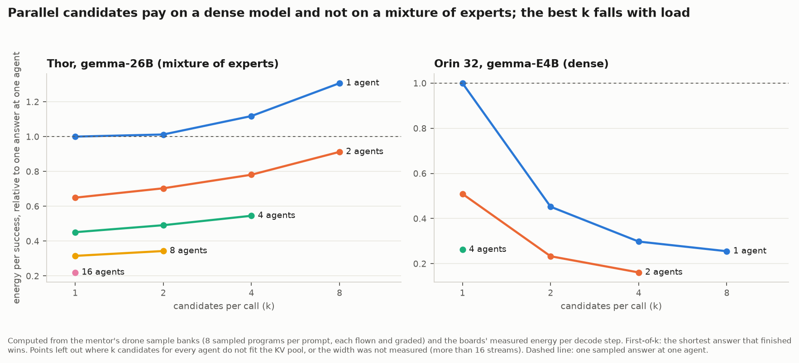

# Parallel candidates: when do they pay? (WF-4 part 1, CAND-T1)

**15 Oct 2026.** Two parts:
- **The bank analysis (done).** It uses the mentor's drone sample banks and cost curves (13–14 Oct, read-only copies in
  `~/work/mentor/` on the WS).
- **The live traffic experiment CAND-T1 (running on Thor-2).** Its plan and rules were fixed before data in
  [`PLAN.md`](PLAN.md).

Code: `analysis/candidates_bank.py` (committed before its results were read). Output: `candidates_bank.json`.

## Bank analysis: first-of-k computed from every subset of 8 sampled answers

**Method:**
- **Banks:** each bank holds 8 sampled answers per prompt (Gemma's model-card sampling), every program flown and
  graded by P1's check.
- **First-of-k:** for k = 1, 2, 4, 8, every k-subset is enumerated. The winner is the shortest answer that finished on
  its own. The pass rate is the winner's.
- **Cost:** the winner's length × the board's measured energy per decode step at A × k streams (A agents, each with
  k candidates) / A.
- **Memory:** A × (prompt + k × winner length) must fit the server's pool.
- **Range:** only measured widths (≤ 16 streams).

| Board, model, prompts | k = 1: winner tokens, pass | k = 4: winner tokens, pass | Energy per decode step, 4 streams against 1 | First-of-4 against one sampled answer, energy per success, one agent | Best k at 1, 2, 4 agents |
| --- | --- | --- | --- | --- | --- |
| Thor-1, gemma-26B (mixture-of-experts), 12 hard prompts | 9,850, 56% | 7,553, 70% | 1.81× | **+12%** (costs more) | 1, 1, 1 |
| Thor-1, gemma-26B, 9 control prompts | 5,904, 88% | 4,135, 88% | 1.81× | **+25%** | 1, 1, 1 |
| Orin-32-1, gemma-E4B (dense), 21 prompts | 7,192, 8.9% | 2,880, 12.6% | 1.05× | **−70%** | 8, 4, 1 (memory) |

**What it shows:**
- **Mixture-of-experts on Thor: candidates buy success, not energy.**
  - First-of-4 raises the pass rate on hard prompts from 56% to 70%, and first-of-8 to 75%.
  - But each extra stream activates other experts, so 4 streams cost 1.81× per step.
  - Sampling had already removed the long degenerate answers: 0 of 168 samples hit the cap. So the winner is only
    23% shorter.
  - Energy per success rises 12–25%. The best k is 1 at every load.
- **Dense on the Orin: candidates are a large energy lever, and the best k must fall with load.**
  - Extra streams cost almost nothing (1.05× at 4).
  - E4B still runs into the cap under sampling (21 of 168 samples), so first-of-k doubles as an escape: the winner is
    60% shorter.
  - At one agent, first-of-4 cuts energy per success by 70%.
  - As agents are added, the 46K-token pool cannot hold all the candidates, so the best k goes from 8 to 4 to 1.
  - A fixed k loses: k = 1 costs 2.7× the adaptive choice on average over 1–4 agents.
  - This rests on few successes: E4B passed 15 of 168 sampled programs.
- **Agents or candidates: on the Orin the board's capacity is better spent on candidates.**
  - Under the Orin's memory limit, the most efficient feasible point is 2 agents with 4 candidates each: 0.16 of one
    answer at one agent.
  - That beats 4 agents with one answer each (0.26). With more than 2 agents, the candidates no longer fit the pool.
  - On Thor's mixture-of-experts model it is the reverse: more agents always help, and candidates never do.
  - Whether to pack more agents or to widen each agent's risky calls depends on the model and the memory.
- **The decision depends on the model's cost curve, on how often it still degenerates under sampling, on load and on
  memory.** That is a run-time decision, not a setting. It is the shape of an answer to "isn't that just a
  recommendation?". But it holds on one of the two boards measured, with a weak model.

**Caveats:**
- The call-level model treats a failed call's retry as an independent repeat at the same cost. It leaves out the
  reflection call and the flight time between attempts, which would favour k > 1 a little.
- The candidates are assumed to decode in lockstep until the winner finishes.
- The cost curves were measured at fixed widths with forced lengths.

## Live traffic experiment (CAND-T1)

Running on Thor-2 after the TRF-3 validation. See [`PLAN.md`](PLAN.md) for the arms (P1's greedy runs; one sampled
answer; first-of-4), the 12 tasks and the rules. Given the bank result on Thor's mixture-of-experts model, first-of-4 is
expected to cost energy on gemma-26B traffic too. The experiment checks whether traffic's chains of capped calls change
that, and what sampling alone does against P1's greedy protocol.

**Gateway check (15 Oct, 00:55, before the arms):** the first-of-k gateway was run against P1's client stack.
- **Client:** langchain 1.4.0, langchain-core 1.6.1, langchain-openai 1.6.0, langgraph 1.2.11, openai 3.8.0, with P1's
  agent module imported so that its sglang reasoning patch applies.
- **Setup:** `ChatOpenAI` built as P1 builds it (streaming with usage, temperature 0, seed 42), a two-tool `create_agent`
  loop, and granite-4.2-8b on the WS (SGLang 0.5.20, P1's parsers).
- **Results:**
  - Direct, k = 1 and k = 4 all completed the task, with tool calls, reasoning and usage intact.
  - At k = 4 every call ran 4 candidates. Each had one winner, the rest were aborted, and different candidates won.
  - SGLang 0.5.16 on Thor-2 accepts the `rid`, `top_k` and `seed` fields the gateway sends.
