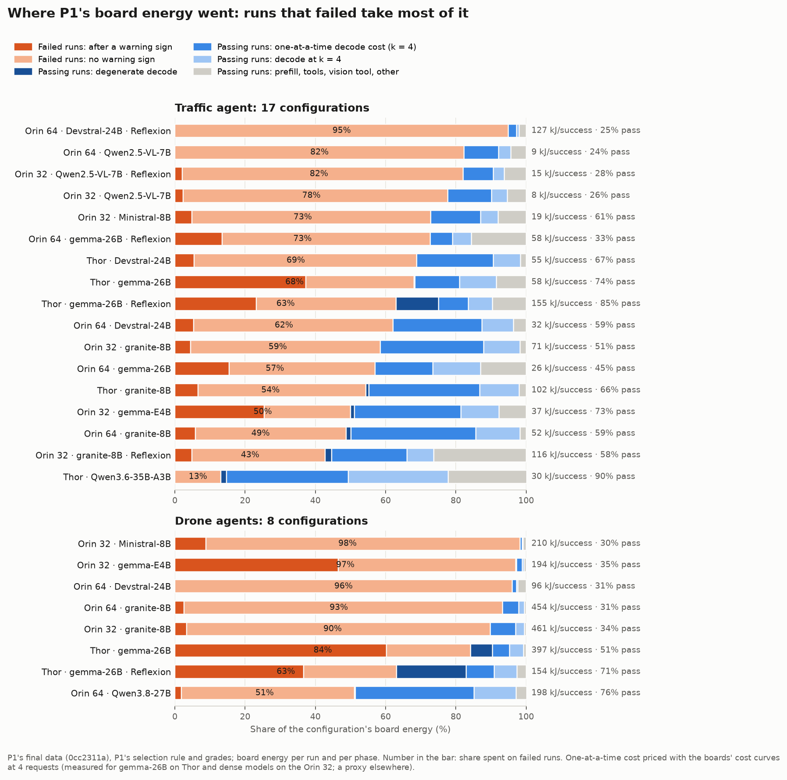

# P5 for the professor: where the energy goes, and what we propose

**Draft, 15 Oct 2026.** This brief prepares the next meeting, on 16 Oct; the presentation is built from it. It answers the questions of
14 Oct (D23). Sources:
- the energy waterfall ([`../2026-10-14-waterfall/`](../2026-10-14-waterfall/README.md));
- the candidates analysis ([`../2026-10-15-candidates/`](../2026-10-15-candidates/README.md));
- the thesis draft ([`../../planning/THESIS.md`](../../planning/THESIS.md));
- the mentor's drone fleets (her doc, 14 Oct);
- the live traffic runs on Thor-2 (§3; slots marked *pending* fill in as the runs end).

## The short answer

1. **Is there an opportunity?** Yes, and it is in decoding.
   - Runs that fail take a median 69% of board energy. That is P1's own headline.
   - Inside passing runs, decoding one request at a time is the largest avoidable part: 2–36% of traffic energy,
     median 17%.
   - Reading prompts and tool waits are small, which is why retention is out.
2. **What do we propose?** A serving layer that spends the board's spare decode width and KV memory in two main ways (§2's options table lists the others, O1–O8):
   - on **more agents** (packing);
   - on **parallel candidates** for an agent's risky calls (first of k sampled answers wins).

   It chooses between them at run time, from the model's cost curve, the load and the free memory, to cut energy per
   successful task.
3. **Why is it not a setting?** The right choice flips:
   - **with the model:** candidates cut energy per success by 70% on a dense model and raise it by 12–25% on a
     mixture-of-experts;
   - **with the load:** the best number of candidates falls from 8 to 4 to 1 as agents are added.

   No fixed setting is best everywhere. A fixed k = 1 costs 2.7× the adaptive choice on the Orin.
4. **What did the workstation work bring?**
   - It closed retention with numbers: at most 3.2% on the board.
   - It built the platform: a gateway with first-of-k, replayers, cost models, and P1's grader reproduced exactly.
   - Every result in this brief is from P1's boards or P1's logs.

## 1. The opportunity: where P1's board energy went

The data is all 25 of P1's edge configurations (17 traffic, 8 drone), from P1's final data with P1's selection rule and
grades.

| Bucket | Share of board energy | Whose finding |
| --- | --- | --- |
| Runs that fail | 13–98%, median 69%; over half in 22 of 25 | P1's paper reports it |
| Decoding one request at a time, in passing runs (priced at 4 together) | traffic 2–36% (median 17%); drone 1–34% (median 5%) | ours |
| Degenerate decoding (calls run to the cap) in passing runs | large on Thor gemma; small elsewhere | P1 (loops) and ours |
| Reading prompts (prefill) | 0–4% | ours, and P1's |
| Tool waits | 0–7% | ours |

**Useful utilization is about 7%.** Only a median 7% of P1's board energy went into the decoding and prompt reading that
passing runs needed, priced at 4 requests decoding together. That is traffic 8% and drones 2%, and it is a lower bound,
because passing runs' tool waits and flight time count as overhead. Seen this way, our metric is goodput per joule:
energy per success = average board power ÷ successful tasks per hour (a suggested framing; THESIS.md §1).

- **Stopping doomed runs is not our core.**
  - The best fixed stop rule leaves at least 15% to the oracle in 24 of 25 configurations.
  - But an online predictor beats that rule in only 3 of 25 on unseen tasks.
  - It also cuts too many passes even when it knows the task's history: both bars are met in 5 of 25.
  - A wrong "stop" loses a success, while a wrong "widen" costs a few percent of decode. So we use the risk estimate
    only to choose which calls get candidates.
- **The two halves of "spare capacity" are visible in P1's logs.** P1 ran one request at a time, so:
  - the decode width the board could add almost for free went unused;
  - so did most of the KV pool on Thor. In our simulation on P1's traces (5 Oct), 8 traffic agents fit Thor's pool and
    cut energy per completed task by 2.2× (gemma) to 3.8× (granite). On the Orins, the pool binds after 2–4 agents.

## 2. The proposal: agents or candidates, chosen at run time

This comes from the mentor's drone sample banks: 8 sampled programs per prompt, each flown and graded. It is combined
with each board's measured energy per decode step.

| Board, model | Cost of 4 streams against 1, per step | First-of-4 against one answer, energy per success | Best k at 1, 2, 4 agents | Best use of spare capacity |
| --- | --- | --- | --- | --- |
| Thor, gemma-26B (mixture of experts) | 1.81× | +12% (hard prompts), +25% (controls); passes 56% → 70% | 1, 1, 1 | more agents |
| Orin 32, gemma-E4B (dense) | 1.05× | **−70%**; passes 8.9% → 12.6% | 8, 4, 1 (memory) | candidates: 2 agents × 4 beat 4 agents × 1 (0.16 against 0.26 of one answer at one agent) |
| Thor-2, granite-8B (dense) | 1.10× (4K context), 1.23× (16K) | *CAND-T2 running* | to be computed | to be measured |

- **Why the answer flips with the model.**
  - On a mixture-of-experts, each extra stream wakes other experts, so width is expensive. Sampling already removed its
    runaway answers.
  - On a dense model, width is nearly free. Candidates double as an escape from answers that still run to the cap.
- **Why it flips with the load.** k candidates per agent must fit the KV pool. As agents are added, the best k falls.
- **The mechanism**, at every agent call:
  - **Inputs:** the model's cost curve, the free KV memory, the agents on the board, and a cheap risk estimate (a
    retry after a failure, signs of a loop or cap, the task's history).
  - **Decision:** how many candidates to run (k ≥ 1). At admission, it also decides whether to take another agent or to
    keep width for candidates.
  - **Selection:** the first candidate that finishes on its own wins, or one that passes a cheap check (it parses, the
    tool call is well-formed).
- **The baseline it must beat (B\*)** is P1's agents with every fixed setting that helps:
  - model-card sampling;
  - the best fixed number of agents per box;
  - FP8 KV where the pool binds;
  - the best fixed k.

  The bar is 15% better in energy per success at the same pass rate (ENERGY_PLAN §5).

### Options for the professor: every way to spend the spare capacity

**For the presentation: one slide with this table.** The professor chooses among the options. We are testing O2 now. O1
and O5 are measured, and the rest are ideas.

The board's slack has three parts:
- decode width (several streams cost little more than one);
- KV memory;
- idle time during tool waits.

Its power can also be cut instead of used. Each option attacks a different part of the energy. Sizes are median shares
of all of P1's board energy (`../2026-10-14-waterfall/waterfall.json`).

| # | Way to spend it | Resource | What it attacks | Size: traffic / drones | Status |
| --- | --- | --- | --- | --- | --- |
| O1 | More agents per board (packing) | width, memory | one-at-a-time decoding | 17% / 5% | **Measured** on drones (the mentor's fleets: 2.3× less energy per success on Thor; the Orin is best at 4 agents). Traffic fleets **not tested** |
| O2 | Parallel candidates, first to finish wins | width | runaway (capped) calls | 7% / 37% | **Testing now.** Drone banks done (Orin dense −70%, Thor MoE +12–25%); traffic CAND-T2 (granite) and CAND-T1 (gemma) running on Thor-2, results today |
| O3 | Parallel candidates checked or voted on (run each candidate's program, keep the majority answer) | width, tool time | wrong answers | 16% / 34% | **Not tested** |
| O4 | Speculative decoding (draft or n-gram tokens verified in one pass; the same answers) | width | one-at-a-time decoding, per token | 17% / 5% | **Not tested**; SGLang supports it |
| O5 | Memory for longer contexts (FP8 KV, fewer agents) | memory | context overflow | 6% / 0% | **Measured** as a setting: FP8 doubles the pool and cuts energy per token 44% (CAP-J1, Orin 32) |
| O6 | A second, smaller model on the board (cascade, router or draft) | memory | wrong and runaway answers, at a lower cost per try | — | **Not tested** |
| O7 | Run the likely next tool call during a wait (prefetch) | idle time | tool waits | 0–7% | **Not tested** (small bucket) |
| O8 | Lower power mode or clocks when the width cannot be used | power | base power in every bucket | not measured | **Not tested**; P1 ran at locked maximum clocks |

Status: **Measured** = a result exists on P1's boards; **Testing now** = runs in progress; **Not tested** = an idea, no data yet.

**What the table says:**
- **O4 is the first gap a reviewer will find.** Speculative decoding uses the same width as packing (O1) and attacks
  the same bucket. "Why not just speculate?" needs a measured answer: in B\* as a setting, or as a third choice for the
  controller.
- **Only candidates (O2, O3) attack failed runs, the largest bucket.** The selection rule decides which failures they
  reach:
  - first to finish catches runaways, which dominate drones and Thor's traffic;
  - a check or vote catches wrong answers, which dominate traffic on most boards.
- **O8 is the "don't spend it" baseline.** P1 ran at locked maximum clocks, so a lower power mode belongs in B\*.
- **Suggested scope:**
  - the core is the run-time split of width and memory among O1, O2 and O4;
  - O5 and O8 join B\* as settings;
  - O3 is a selection variant of O2;
  - O6 and O7 are future work.

## 3. Evidence on P1's boards

**Drones: the mentor's fleets.** These are N copies of P1's Reflexion drone agent, unchanged, on one board with
SGLang's default scheduler. The numbers come from her run summaries, read on the units on 15 Oct at 01:00, and from
her doc for P1's single-drone column.

| Board, model, missions | Drones per board | Passed | kJ per success | Missions per hour | p95 mission time |
| --- | --- | --- | --- | --- | --- |
| Thor-1, gemma-26B (MoE), 21 hard missions | 1 (P1, recorded) | about 17.3 expected | about 131 | about 2.3 | about 69 min |
| | 4 | 16 | 80.3 | 4.5 | 2.3 h |
| | 8 | 17 | **58.2** | 6.0 | 3.5 h |
| Orin-32-1, gemma-E4B (dense), 36 missions | 2 | 17 | 35.7 | 7.5 | 29 min |
| | 4 | 17 | **25.7** | 11.1 | 1.8 h |
| | 8 | 17 | 29.0 | 9.8 | 2.2 h |

- **Packing pays on both boards at the same pass count.** On Thor, 8 drones cost 2.3× less per success than P1's
  single drone.
- **The best number of agents differs by board.** Thor is still improving at 8. The Orin is best at 4 and worse at 8:
  E4B's 46,645-token pool binds, as P1's logs predicted (§1).
- **Packing's price is each mission's latency.** p95 mission time grows nearly 4× from 2 to 4 agents on the Orin, and
  rises to 3.5 h at 8 on Thor.
- **The open question for the controller:** on the Orin, the bank analysis says the capacity past 2 agents is better
  spent on candidates (2 agents × 4 candidates). The live test is a 2-drone fleet with first-of-4 against the 4-drone
  fleet above.
- **Still running (15 Oct, 01:00):**
  - Thor-1: step-wise fleet, gemma-26B, 4 drones. So far 9 of 12 missions passed; all 7 short B-tasks passed.
  - Orin-32-2: step-wise fleet, granite, 2 drones.
  - Orin-32-3: Reflexion fleet, granite, 4 drones.

**Traffic: P1's agent, unchanged, on Thor-2 (ours, 15 Oct).**
- **Is the platform faithful to P1? Yes.** TRF-3 ran gemma-26B with P1's greedy protocol, graded by P1's grader (which
  reproduces 336 of 336 of P1's grades), on 7 of 9 tasks; Thor-2's crash cut the other 2, which rerun later today.
  - We passed 7 of 7, where P1 passed 22 of 28 on the same tasks.
  - Our energy lies within P1's own min–max on 5 of 7 tasks.
  - Per generated token, our energy is within 3–7% of P1's on 5 of 7 tasks.
  - Where we differ, the agent took a different path (more calls), as P1's own repeats do.

  Details: [`../2026-10-14-traffic-agent/`](../2026-10-14-traffic-agent/README.md).
- **Do candidates pay on a dense model?** CAND-T2 runs granite-8B on 10 tasks, one sampled answer (S1) against
  first-of-4 (F4). The rules were fixed before the data.
  - **S1 done:** one sampled answer passed 6 of 10 at 126 kJ per success, with no capped calls in the traces. P1's
    greedy runs of the same tasks passed 15 of 30 at 152 kJ, with 8 capped calls. This is cross-setup and one repeat,
    so it is not read as an effect.
  - *pending (≈17:30): F4 and the verdict.*
  - Granite's cost curve on Thor is in: 4 streams cost 1.10× per step at a 4K context and 1.23× at 16K. Extra width is
    cheap on a dense model on Thor too.
- **And on the mixture-of-experts?** CAND-T1 runs gemma-26B on 12 tasks, S1 against F4.
  - *pending (≈21:00).* The bank analysis predicts that first-of-4 costs energy here.
- **An edge lesson from the platform:** P1's server flags reserve 80% of Thor's unified memory for the model server.
  Our live agent run exhausted the rest and crashed the board (15 Oct, 01:24). Memory left beside the server is part of
  the capacity problem the controller must manage, not a fixed setting.

## 4. The critiques of 14 Oct, answered

| Critique | Answer |
| --- | --- |
| "What did the WS experiments bring?" | They closed retention with numbers, built the platform, and found the decode-width lever. All new results are on P1's boards |
| "FP8 to enlarge the pool is common sense, just a recommendation" | Agreed. FP8, packing and sampling are settings. They join B\*, the baseline we must beat by 15% |
| "Multiple agents help, so what?" | Packing alone is a setting. What is not a setting is how to split spare width between agents and candidates: the split flips with the model and the load, and packing costs latency (p95 69 min → 3.5 h) |
| "How does it look as a paper?" | See the outline below |

**Paper outline (working):**
- **Claim:** edge boards serving LLM agents waste their spare decode width and memory. A serving layer that spends them
  on agents or on candidates, chosen at run time, cuts energy per successful task against the best fixed configuration.
- **Measurement:** the energy waterfall over P1's 25 configurations. Where the joules go, and what is avoidable.
- **Design:** the controller (inputs, decision, selection), inside SGLang's serving path, through our gateway.
- **Evaluation:**
  - 2 agent families (traffic, drones), each with P1's agents unchanged except for sampling;
  - Thor and Orin boards, MoE and dense models, 1 to N agents;
  - against P1 as run and against B\*;
  - energy per success, pass rate, p95 latency.
- **Related work:**
  - parallel sampling with first-to-finish for reasoning (short-m@k, SART): fixed k, no energy, no agents;
  - EdgeReasoning (energy of reasoning on a Jetson): measurement only;
  - agent schedulers (Continuum, Autellix): latency, not energy.

## 5. Path to OSDI (abstract 1 Dec, paper 8 Dec)

| By | What | Who |
| --- | --- | --- |
| 25 Oct | The controller, first version, in the gateway. B\* measured on traffic (Thor-2) and drones (the mentor's fleets) | Sandesh with Claude; the mentor |
| 8 Nov | Live fleets with the controller: traffic on Thor-2 and an Orin, drones on Thor and the Orins | both |
| 22 Nov | Full evaluation, ablations, sensitivity (pool size, model) | both |
| 1 Dec | Abstract | both |
| 8 Dec | Paper | both |

**Fallback:** if no run-time policy beats B\* by 15%, the paper becomes a measured design space. That is the waterfall,
plus the agents-against-candidates map per board and model. We tell the professor as soon as that is clear.

## 6. Decisions for the professor

1. Is "spend spare width and memory on agents or candidates, chosen at run time" the proposal he asked for?
2. Candidates need sampling, while P1 ran greedy. Is switching to the model card's sampling an acceptable, justified
   change to P1's agents?
3. If candidates pay only on dense models (the Orin class), is a story centred on Orin-class boards acceptable? Or must
   it hold on Thor's mixture-of-experts too, where packing alone wins?
4. **The metric's framing:** energy per success presented as goodput per joule, with a deadline per task so that
   latency counts? The deadlines would have to be chosen per workload.
5. **Scope:** do speculative decoding and the board's power mode go into B\* as settings, or into the controller as
   run-time choices?
6. **The split with P1:** failed-run energy and offline stop policies stay P1's. P5 claims the online, multi-agent
   decision. Is that right?
